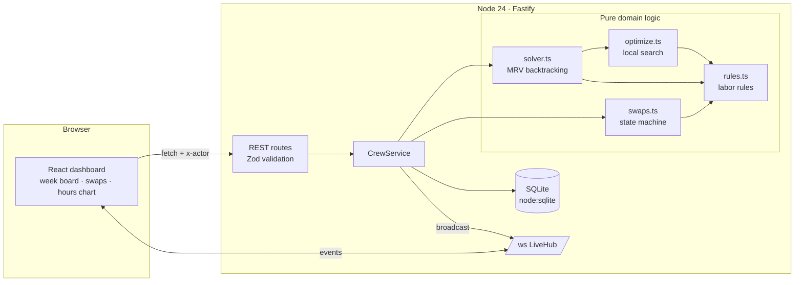
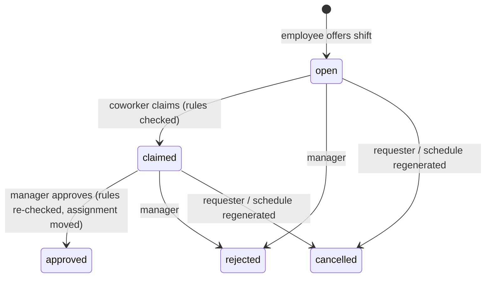

# Crewboard

**Shift scheduling for small restaurants that respects labor rules, keeps hours fair, and lets staff swap shifts without breaking either.**

[](https://github.com/yashchhabra57/crewboard/actions/workflows/ci.yml)

## The problem

Most independent restaurants still schedule in a spreadsheet or a group chat. The manager spends hours each week fitting people into shifts, and the expensive mistakes are easy to miss:

- a **"clopening"**: someone closes at 11pm and opens at 6am,
- a **minor scheduled past curfew** or over their weekly hour limit,
- **surprise overtime** because one person kept picking up shifts,
- a **shift swap** agreed over text that quietly breaks one of the rules above.

Crewboard generates the week automatically under those rules, shows the manager *why* a seat is empty when it can't be filled, and runs shift swaps through a request → claim → approve flow that re-checks every rule before anything changes. Everyone sees updates live.

## What it does

- **Constraint solver** fills every shift seat while enforcing role training, availability, no double-booking, a minimum rest period between shifts, personal weekly hour caps, max consecutive days, and minor rules (daily/weekly caps and a curfew).
- **Optimizer** then improves the solved week for labor cost (overtime-aware) and fairness (how evenly people are loaded against the hours they asked for).
- **Explains empty seats**: for each seat it can't fill, it lists how many people were blocked by each rule ("8 not trained, 6 rest period, 14 at hour cap").
- **Shift-swap workflow** with role-based actions, targeted or open offers, a "who can legally cover?" lookup, and re-validation at approval time.
- **Live dashboard** over WebSockets: week board, hours-vs-cap chart, swap queue, cost and overtime totals.

## Architecture



Everything under `src/server/domain` is pure TypeScript with no I/O, so the solver, optimizer and swap rules are unit-tested directly. The service layer loads state from SQLite, calls the domain, persists the result in a transaction, and broadcasts a small typed event. Clients refetch on each event, so a missed message never leaves a stale screen.

### Swap workflow



## Tech stack

| Layer | Choice |
|---|---|
| Language | TypeScript (strict, `noUncheckedIndexedAccess`) |
| Server | Node 24, Fastify 5, `@fastify/websocket`, Zod 4 |
| Storage | SQLite through Node's built-in `node:sqlite` (no native addon) |
| Client | React 19, Vite 8, plain CSS with light/dark tokens |
| Tests | Vitest (unit, property, API via `inject`, real WebSocket), end-to-end smoke script |
| CI/CD | GitHub Actions: lint → typecheck → test → build → smoke → bench |
| Deploy | Multi-stage Dockerfile, env-based config |

## Running it

Requires Node 24+.

```bash
npm install
npm run build
npm start            # http://localhost:3000, seeds the demo week on first run
```

For development, run the API and the Vite dev server (which proxies `/api` and `/ws`) in two terminals:

```bash
npm run dev          # API on :3000 with reload
npm run dev:web      # client on :5173
```

Use the **Acting as** dropdown to switch between the manager and any employee. Try: as an employee, *Offer swap* on one of your shifts; switch to a coworker and *Take shift*; switch to Manager and *Approve*. Open a second tab to watch it update live.

Other scripts:

```bash
npm test             # 52 unit + integration tests
npm run smoke        # boots the built app and drives a full swap over HTTP + WebSocket
npm run bench        # solves the demo week and prints timing and quality numbers
npm run lint
npm run typecheck
```

Configuration (see `.env.example`): `PORT`, `HOST`, `DATABASE_PATH`, `SEED_DEMO`.

### API sketch

| Method | Path | Who |
|---|---|---|
| GET | `/api/schedule` | anyone: shifts, assignments, rules, report |
| POST | `/api/schedule/generate` | manager: solve + optimize + publish |
| POST | `/api/employees`, `/api/shifts`; PUT `/api/rules` | manager |
| GET/POST | `/api/swaps` | employee offers a shift they work |
| GET | `/api/swaps/:id/candidates` | who can legally take it |
| POST | `/api/swaps/:id/{claim,approve,reject,cancel}` | per role |
| WS | `/ws` | `schedule.updated`, `swap.updated` events |

Rule failures come back as `422` with machine-readable violations, e.g. `{ "code": "REST", "message": "Ben Fischer would get only 8h of rest next to the Mon 16:00 shift (min 10h)" }`.

## Engineering notes

**Time model.** Every time is "minutes since Monday 00:00", so a Friday 6pm–1am shift is just `[5400, 5820)`. Overlap, rest gaps and overnight shifts become plain integer comparisons with no date library.

**Solver.** Each shift expands into seats. Depth-first search always branches on the seat with the *fewest* legal candidates right now (minimum remaining values), trying the least-loaded and cheapest people first. Leaving a seat empty is the last branch, so an understaffed week still gets the best partial schedule instead of an error. Branch-and-bound uses a simple lower bound: every open seat with zero candidates must end up empty. A node budget (default 50k) keeps response time bounded, and a greedy pass backs it up if the budget runs out before any complete leaf.

**Making it fast.** The first version recomputed every seat's candidates at every node using the same message-building checker the API uses. On the 17-person demo week it ran for more than three minutes. Two changes brought it to about 0.1s:
1. *Forward checking*: each seat keeps a candidate set. Assigning employee X can only change X's legality elsewhere, so after an assignment only X is re-checked, and removals go on a trail that is undone on backtrack.
2. *A fast legality path*: `isDynamicallyLegal` is allocation-free and exits on the first broken rule. A property test runs 2,000 random cases to make sure it always agrees with the detailed `dynamicViolations`.

**Optimizer.** Best-improvement hill climbing over three moves: fill an empty seat, reassign a seat, or swap two people between shifts. Swaps matter: when two overlapping shifts are held by the wrong people, no single reassignment is legal, but a swap is (there's a test for exactly this). The objective is `10,000 × empty seats + labor cost + 2,000 × utilization variance`. On the demo week it raises the least-loaded person from 44% to 75% of their requested hours for about $40 more in labor, a tradeoff the weights make explicit and tunable.

**Swap safety.** Rules are checked when a coworker claims a shift (fast feedback) and again when the manager approves, because the week may have changed in between. The approval and the assignment move commit in one SQLite transaction. Regenerating the schedule cancels open swaps with a recorded reason rather than leaving them pointing at assignments that no longer exist.

**Transactions.** `Store.transaction` is re-entrant via savepoints, so repository methods can be atomic on their own and still compose inside a service-level transaction. This was a real bug caught by the API tests.

## Demo numbers

From `npm run bench` on the seeded Lakeside Diner week (17 staff, 2 minors, 68 seats):

| | |
|---|---|
| Seats filled | 67/68 from the bench's input order (the app's run fills 68/68) |
| Solve + optimize | ~150 ms |
| Overtime | 0h |
| Lowest utilization | 0.44 → 0.75 after optimizing |

## Limitations (honest)

- **No real auth.** The client says who it is with an `x-actor` header. This is fine for a demo and not for production; the next step is sessions or OIDC with manager/employee roles.
- **One week, one location.** There's no calendar of weeks, templates, or multiple stores yet.
- **Not provably optimal.** The search stops at its node budget, so the result can depend on input order (above: 67 vs 68 seats). Seats of the same shift are interchangeable, but the search doesn't break that symmetry yet, which wastes nodes.
- **Labor rules are illustrative.** The defaults loosely follow common US rules, and every state and city differs. They are configurable via `PUT /api/rules`, but nothing here is legal advice.
- **Single-node live updates.** The WebSocket hub is in memory. Running more than one server instance would need Redis pub/sub or similar.
- The web UI was checked by the smoke test (it serves the built client and drives every API path the UI uses), not by browser automation.

## Roadmap

- [ ] Real authentication and per-restaurant tenancy (Postgres with row-level security)
- [ ] Symmetry breaking and a stronger bound (e.g. a matching relaxation) for provable optimality
- [ ] Availability and time-off requests submitted by employees
- [ ] Shift templates and copy-last-week
- [ ] SMS/push notification when a swap is offered to you
- [ ] Redis pub/sub so live updates work across instances
- [ ] Playwright tests for the dashboard

## License

MIT
